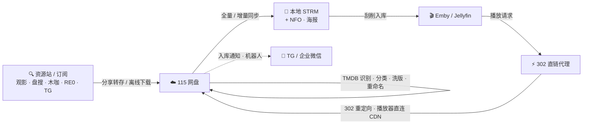

<div align="center">

# 115-Station

**把 115 网盘变成你的私人影院**

从找资源、转存、识别整理，到刮削入库、302 直链秒播，一个后台全自动跑完。

115 网盘 STRM 生成 · 302 直链播放 · Emby / Jellyfin 自动入库 · TMDB 识别刮削 · 洗版 · 资源订阅 · TG / 企业微信机器人

*115 cloud drive → STRM for Emby & Jellyfin, with 302 direct-link playback, auto organize, TMDB scraping and subscriptions.*

[](https://github.com/pancras-loe/115-station/pkgs/container/115-station)


[](https://t.me/+7b_HYMltYMozZTk1)

[快速部署](#-三分钟部署) · [亮点功能](#-亮点功能) · [使用文档](USAGE.md) · [完整 Wiki](wiki/index.html) · [交流群](#-交流群) · [English](#english)


</div>

---

## 它能帮你做什么

> 在找资源页点一下「订阅」，剩下的事你就不用管了。

新一集播出 → 自动去各资源站找 → 只转存缺的那一集 → 识别、改名、归类 → 写入 STRM → 刮削海报和中文演员 → 通知 Emby 入库 → 推送到你的 TG / 企业微信 → 打开 Emby 直接播放，**流量全走 115 CDN，服务器一个字节都不转发**。



---

## ✨ 亮点功能

### ⚡ 零流量播放，播放器直连 115

- STRM 里只存短链，播放时 **302 跳转到 115 CDN**，服务器不中转、不吃带宽，小鸡也能带 4K 原盘
- 自带 **Emby 反代**，客户端换个端口就能用
- 入库后**提前让 Emby 探测媒体信息**：音轨、字幕、编码提前就绪，第一次点开不用干等；每个条目严格记账，绝不重复取直链

### 🔄 增量同步：网盘一变，本地立刻跟上

- 基于 115 **生活事件流**，手机上传、离线完成、网页端删改都能被感知
- 只处理发生变化的那一层目录，**不反复全盘遍历**，对 115 风控友好
- 网盘上删了片，Emby 那边同步消失；Emby 里删了片，也可以**联动删网盘源文件**（默认关闭，多重越界守卫，删除只进回收站）

### 🧠 一条龙智能整理

识别 → 分类 → 洗版 → 重命名 → 搬移 → 写 STRM → 刮削 → 刷新 Emby，**全程在 115 网盘内完成**，不下载、不中转。

| 能力 | 说明 |
|---|---|
| **认得准** | TMDB 多策略识别，每个候选都要过片名校验，绝不「取第一条凑合」；搜不到时可交给 **AI 增强识别**改写片名再找 |
| **防认错** | 碰到同名作品（如动画版与真人版）、年份也区分不了时**主动停下问你**，而不是悄悄顶掉库里的片 |
| **剧集细节** | 多季合集逐集拆季、全剧连续编号自动换算成季内集号、双集文件、特别篇按 TMDB 第 0 季集名对号 |
| **自动洗版** | 按你的画质偏好（分辨率 / HDR / 编码 / 字幕组…）自动保留更好的版本，旧版让位，几百集也是整批一次搬完 |
| **撞名不乱改** | 同一集的粤语 / 国语两份改名撞车时，交给你选「只留一份」还是「都留」，TG 上点按钮就行 |
| **可回头** | 识别错了？在整理记录里改指定 TMDB，一键重新整理；也可以开「人工确认」，先看再入库 |
| **二级分类** | YAML 规则按类型 / 地区 / 语言 / 类别分目录，重命名模板变量与 CMS 对齐 |

### 🎯 影视转存：一部片，五个来源一起搜

- 选定 TMDB 条目后，**观影、盘搜、木咖、RE0、TG 频道**并行搜索，慢的不拖累快的
- 每条资源都标好**画质标签、相关性、洗版偏好排名**，提交过的一眼可见
- 支持 115 分享、磁力、ed2k 离线，一次可贴多个链接；转存完由守望者自动接手整理
- 没在搜东西时首页铺 **TMDB 趋势 / 热门榜单**，看到想看的点一下就能找资源

### 📺 资源订阅：追更不用守着

- 按 TMDB 条目订阅，**缺哪集算哪集**（对照 TMDB 播出表与本地台账，零 115 请求）
- 115 分享**只转缺的那几集**，转之前先看分享里到底有什么，整季包也能精准挑集
- 新集播出后高频查找，补老集低频巡检；找不到会告诉你，不会默默放弃
- 分辨率、HDR、编码、发布组、中字、单集大小等**资源条件**点选即可
- 离线配额有多道保护：每月上限、配额余量、单集磁力不下；RE0 积分解锁有单条上限与每日预算
- 能识别「订的是动画、标题却是真人版」这类同名陷阱，从源头上拦下

### 🖼️ 海报墙与刮削

- 本地媒体库一张卡片一部片，刮削是否齐全、Emby 有没有探测完，一眼看清
- **每个媒体库自选**：本站自动刮 / 只手动刮 / 交给 Emby
- 写 NFO、海报、背景图、剧照，占位剧照自动识别跳过
- **演职人员补全**：给 Emby 里的演员、导演补上 TMDB 头像与**简体中文名**，可合并重复人物，并同步回本地 NFO
- **与 Emby 对账**：数量对不上时逐条告诉你差在哪儿

### 🗂️ 多媒体库

- 主库之外可挂附加媒体库，分类规则一行 `library:` 就能把动画、纪录片分到不同库
- 转存目录的子目录可以**按来源绑定库**（比如「4K」子目录专进 4K 库）
- 已经自己整理好的库可以设为「我自己整理」，本站只同步不动它

### 🤖 消息机器人

- **Telegram / 企业微信双向机器人**：搜片、搜资源、一键转存、订阅、管理订阅、触发整理与同步
- 发一条磁力或分享链接就开始下载，入库后自动推送通知（多集防抖合并）
- 飞书、OneBot、QQ 官方机器人推送

### 📋 任务中心

- 所有操作入队执行，整理、刮削、探测、演职人员、订阅**五条队列各跑各的**，互不阻塞
- 实时进度、历史筛选、失败重试、随时停止；任务与整理记录互相跳转

### 🛡️ 稳与安全

- 115 请求**全局限流**（读 1s / 写 3s），批量写入合并执行，风控友好
- 删除一律进 115 回收站，空目录清理有层层守卫，宁可不删也不误删
- 登录支持 **TOTP 二步验证**、防爆破；优雅退出，不留半截状态
- 暗色「影院风」界面，**手机端完整适配**

---

## 🚀 三分钟部署

镜像发布在 GitHub Container Registry，支持 `linux/amd64` 与 `linux/arm64`。

新建一个目录，写入 `docker-compose.yml`（仓库根目录已附带一份）：

```yaml
services:
  station:
    image: ghcr.io/pancras-loe/115-station:latest
    container_name: 115-station
    restart: unless-stopped
    stop_grace_period: 20s    # 优雅退出窗口：SIGTERM 后程序需要 ~3 秒收尾
    ports:
      - "6060:6060"   # 管理后台
      - "6086:6086"   # 302 直链代理
    volumes:
      - ./config:/config
      - ./data:/data
      - ./media:/media
      - ./logs:/logs
    environment:
      - TZ=Asia/Shanghai
      - AUTH_USER=admin          # 管理后台账号（环境变量管理，无网页注册）
      - AUTH_PASSWORD=change-me  # ★ 改成强密码；修改后 docker compose up -d 生效
```

```bash
docker compose up -d
```

浏览器打开 `http://<服务器IP>:6060` 登录即可。

| 端口 | 用途 |
|---|---|
| 6060 | 管理后台（网页） |
| 6086 | 302 直链代理（Emby 播放走这里，含 `/emby` 反代） |

### 上手五步

登录后总览面板顶部有一张**上手清单**，按顺序列出下面这几步、自动判定做没做，点一下直接跳到要填的地方。

1. 用 `AUTH_USER` / `AUTH_PASSWORD` 登录后台
2. **账号与媒体库**：扫码或 OpenAPI 授权登录 115，一键创建工作目录
3. **Strm 管理**：填直链域名，配置网盘媒体库与本地 `/media`，跑一次全量同步
4. 在 Emby 中添加媒体库指向 `/media`，客户端通过 **6086** 端口访问 Emby，播放即直连 CDN
5. **自动整理**：配置 TMDB、分类、洗版、重命名规则，往转存目录丢点东西试试

详细说明见 **[USAGE.md 使用文档](USAGE.md)**，或打开 [`wiki/index.html`](wiki/index.html) 查看完整版 Wiki。

<details>
<summary><b>镜像 tag 说明</b></summary>

| tag | 含义 |
|---|---|
| `latest` / `master` | master 最新一次构建，滚动更新 |
| `26.10.15` / `26.10` | 按发版日期命名的正式版，打 `v*` git tag 时产出，适合要稳定性的部署 |

</details>

<details>
<summary><b>管理员账号、二步验证与登录有效期</b></summary>

- 网页注册已移除。账号以环境变量 `AUTH_USER` / `AUTH_PASSWORD` 为准，每次启动自动同步；
  两者都未配置且无历史账号时，首次启动会自动生成随机密码并打印在容器日志（`docker logs 115-station`）。
- 改环境变量即改密码，重启生效。容器内也可执行 `./115-station --reset-admin` 只删账号文件而保留其他配置。
- 「系统配置 → 登录安全」可绑定手机身份验证器（TOTP），开启后登录要再输 6 位验证码；
  丢了验证器时加环境变量 `AUTH_OTP_RESET=true` 重启一次即可关闭。
- 登录令牌有效期与 MoviePilot 一致，默认 8 天，环境变量 `ACCESS_TOKEN_EXPIRE_MINUTES`（分钟）可改。

</details>

<details>
<summary><b>如何更新</b></summary>

后台每 12 小时检查一次 GitHub 上的新版本，有新版时侧栏版本号旁出现小红点，
「系统配置 → 版本更新」里能看更新说明，也可以打开通知推送（同一个版本只推一次）。

**一键更新**：「版本更新」里点「立即更新」，或者给机器人发 `/update`（企微发「检查更新」）。
程序会从 ghcr.io 下载新版本的程序、校验后重启容器换上，**不需要挂 Docker socket**；
靠容器的重启策略拉起来（自带的 docker-compose.yml 是 `restart: unless-stopped`）。
一键更新只换程序，镜像本身不变；碰到改了运行环境的版本，界面会提示改用下面的命令。

也可以自己拉镜像更新：

```bash
docker compose pull && docker compose up -d
```

配置与数据都在挂载卷里，不受影响。检测走「代理配置」里的代理；不想让它联网，在「版本更新」里关掉定时检查即可。

</details>

<details>
<summary><b>自行构建</b></summary>

```bash
git clone https://github.com/pancras-loe/115-station.git && cd 115-station
```

把 compose 里的 `image:` 换成 `build: .`，然后：

```bash
docker compose up -d --build
```

</details>

<details>
<summary><b>本地开发</b></summary>

需要 Go 1.25+。

```bash
go build ./... && go vet ./... && go test ./... -count=1
```

不走容器直接跑时，需要准备 `/config`、`/data`、`/media`、`/logs` 四个目录，
或用 `CONFIG_DIR` / `DATA_DIR` 环境变量指到本地路径。前端在 `webui/`，说明见 [webui/README.md](webui/README.md)。

项目结构与开发约定见 **[AGENTS.md](AGENTS.md)**。

</details>

---

## ⚠️ 注意事项

- 115 对高频请求有风控，**不要把 API 间隔调低于默认值**；写入类操作保持 ≥3s
- 公网部署请配置强 `AUTH_PASSWORD`、开启二步验证并使用 HTTPS 反代；`JWT_SECRET` 不设置会自动生成并持久化，无需手工管理
- STRM 目录（`/media`）需要 Emby 同时挂载，路径不一致时在 Emby 配置里设置路径映射（`本地路径#Emby路径`）
- 容器停止请给足优雅退出窗口（`stop_grace_period: 20s`），否则可能留下「115 已搬移、台账未写」的中间态

---

## 💬 交流群

使用问题、Bug 反馈、版本更新，都在群里聊：

<table>
<tr>
<td align="center" width="50%">
<b>Telegram</b><br><br>
<a href="https://t.me/+7b_HYMltYMozZTk1">点击加入 Telegram 交流群 →</a>
</td>
<td align="center" width="50%">
<b>QQ 交流群</b><br>手机 QQ 扫码加入<br><br>

</td>
</tr>
</table>

---

## English

**115-Station** is a self-hosted media hub for the **115 cloud drive (115网盘)**. It mirrors your 115 library as local **STRM** files for **Emby / Jellyfin**, and plays them through a **302 redirect** so the player streams straight from 115's CDN — your server forwards no video traffic.

- **STRM sync** — full and incremental (115 life events), with dead-STRM detection
- **Auto organize** — TMDB recognition, category rules, rename templates, quality upgrade ("wash") and dedupe
- **Scraping** — NFO, posters, Chinese cast names and avatars, Emby pre-probing of media info
- **Resource search & subscriptions** — search multiple sites by TMDB title, save 115 shares or offline-download only the missing episodes
- **Bots & notifications** — Telegram / WeCom (企业微信) bots, Feishu, OneBot
- **Deploy** — single Go binary + Vue 3 web UI, Docker image for amd64 / arm64

The UI and docs are in Chinese. See [三分钟部署](#-三分钟部署) for the `docker compose` setup.

---

## 许可证与再分发声明

本项目基于 [DaisyYijin/STRMhub](https://github.com/DaisyYijin/STRMhub) 的代码开发，该代码未附带开源许可证，
按 GitHub 服务条款与著作权法的通行规则默认为「保留所有权利」。因此本仓库**不附带 LICENSE 文件，
也不作任何开源授权声明**；ghcr 上的镜像同样适用这一状况，使用者请自行判断是否接受。

第三方组件的许可证义务独立于上述状况，所需的版权声明与许可证副本见 [`licenses/`](licenses/)
与 [THIRD-PARTY-NOTICES.md](THIRD-PARTY-NOTICES.md)。

## 免责声明

本项目仅供个人学习与技术研究使用。使用者需自行承担因使用本项目产生的一切后果，
包括但不限于账号风控、数据丢失、服务中断。请遵守 115 网盘及各资源站的用户协议与当地法律法规，
不要用于任何侵犯他人著作权的用途。

---

<div align="center">

### ☕ 请作者喝咖啡

如果这个工具帮到了你，欢迎扫码请作者喝杯咖啡


</div>
