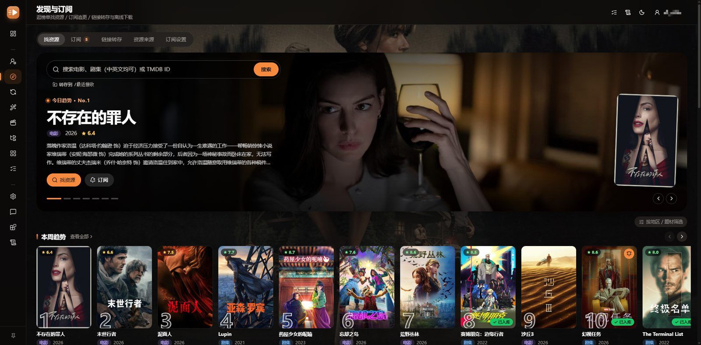
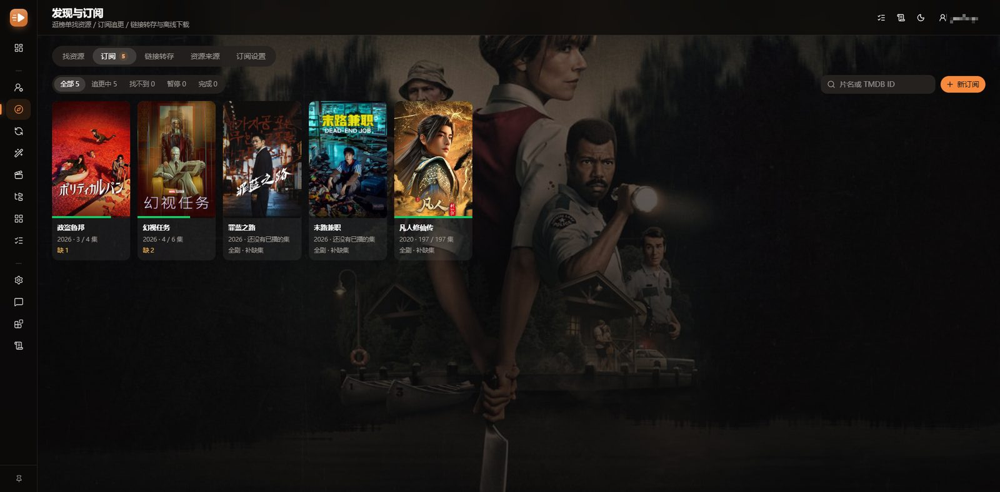
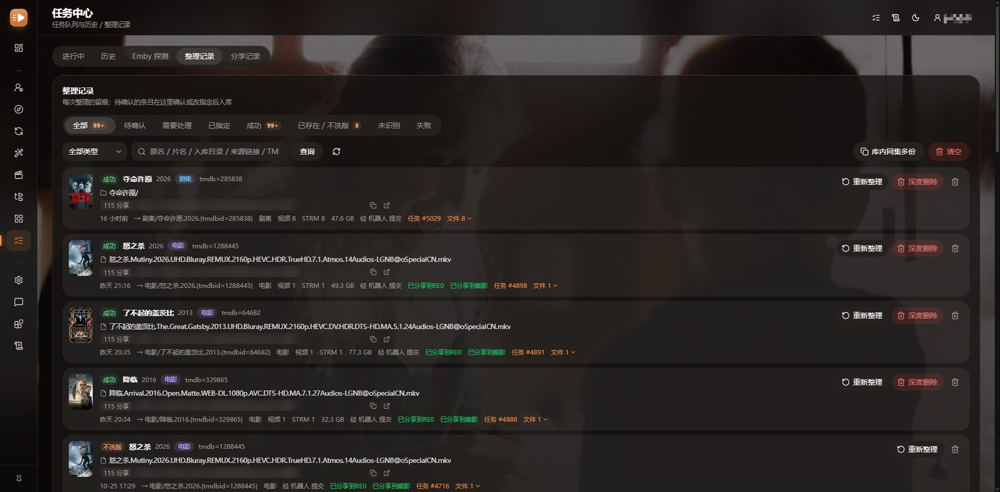
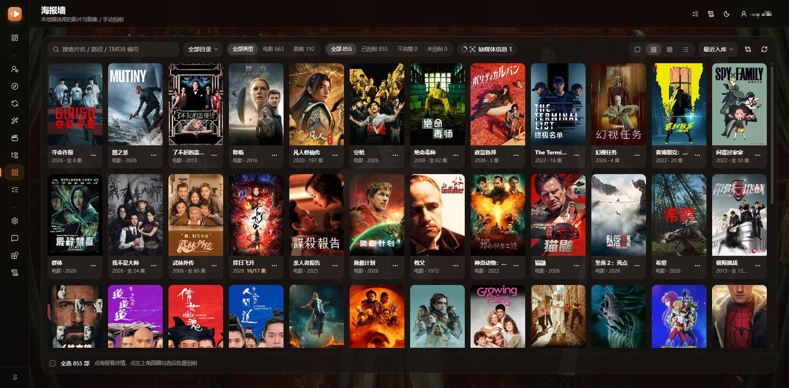
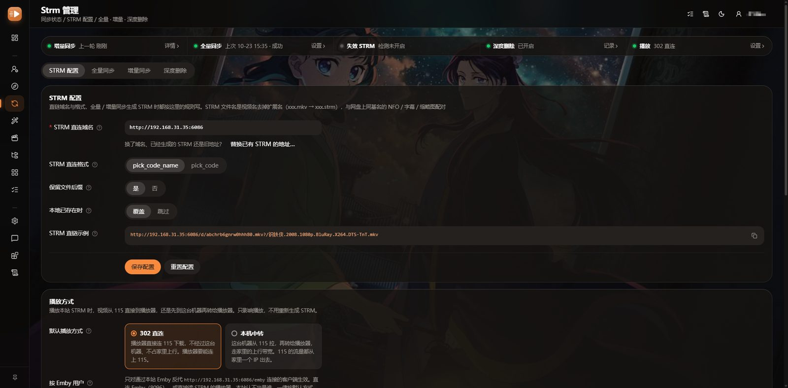
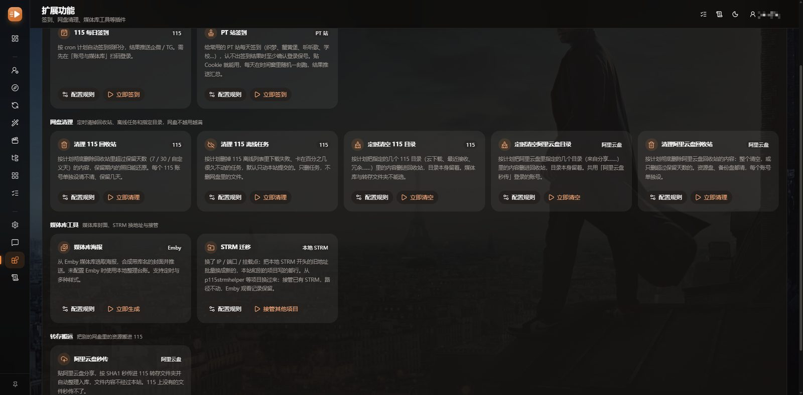
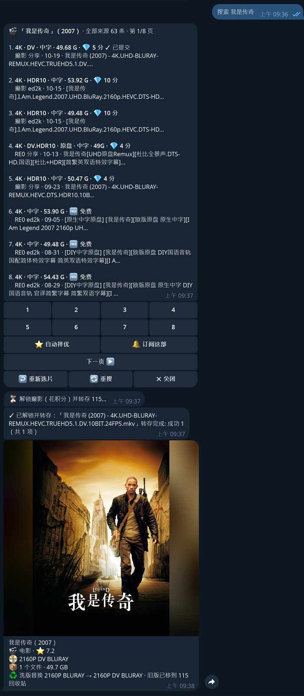
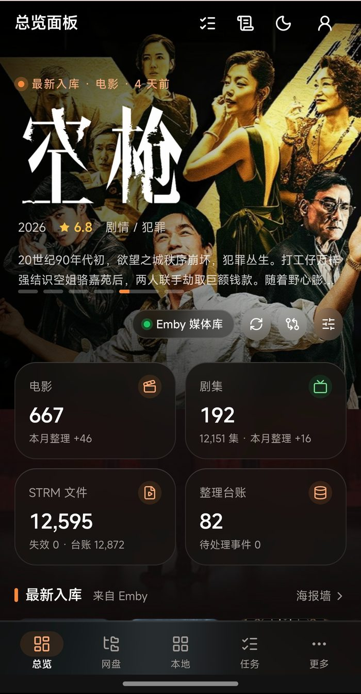

<div align="center">

# 115-Station

**把 115 网盘变成你的私人影院**

找资源 → 转存 → 识别整理 → 刮削入库 → 302 直链秒播，一个后台全自动跑完。

*115 cloud drive → STRM for Emby & Jellyfin, with 302 direct-link playback, auto organize, TMDB scraping and subscriptions.*

[](https://github.com/pancras-loe/115-station/pkgs/container/115-station)


[](https://t.me/+7b_HYMltYMozZTk1)

[部署](#-部署) · [使用文档](USAGE.md) · [完整 Wiki](wiki/index.html) · [交流群](#-交流群) · [English](#english)


</div>

## ✨ 一图一功能

<table>
<tr>
<td width="50%" valign="top">
<br>
<b>🎯 发现与找资源</b><br>
TMDB 榜单当首页，选一部片，观影 / 盘搜 / 木咖 / RE0 / 癫影 / TG 频道一起搜，画质与洗版排名标好
</td>
<td width="50%" valign="top">
<br>
<b>📺 资源订阅</b><br>
缺哪集算哪集，115 分享只转缺的那几集；新集播出后高频查，补齐后还能继续洗版
</td>
</tr>
<tr>
<td valign="top">
<br>
<b>🧠 自动整理</b><br>
识别 → 分类 → 洗版 → 重命名 → 写 STRM → 刮削 → 刷 Emby，全程在网盘内完成；同名、撞名、洗版拿不准时停下问你
</td>
<td valign="top">
<br>
<b>🖼️ 海报墙</b><br>
一张卡片一部片，刮全没有、Emby 探测完没有一眼看清；NFO、海报、中文演员名一并补齐
</td>
</tr>
<tr>
<td valign="top">
<br>
<b>⚡ STRM 与 302 播放</b><br>
全量 + 生活事件增量同步；播放 302 直连 115 CDN，服务器不转发流量，也可按用户改成本机中转
</td>
<td valign="top">
<br>
<b>🧩 扩展功能</b><br>
阿里云盘秒传、PT 站签到、115 回收站 / 离线任务定时清理、接管其他项目的 STRM……按需开启，各带日志
</td>
</tr>
<tr>
<td valign="top">
<br>
<b>🤖 TG / 企业微信机器人</b><br>
搜片、挑资源、一键转存、订阅、检查更新；入库通知合并推送，另有飞书 / QQ / IYUU / Webhook
</td>
<td valign="top">
<br>
<b>📱 手机端</b><br>
完整适配，底部导航；暗色影院风界面，背景剧照 + 毛玻璃
</td>
</tr>
</table>

另外还有：多 115 账号与多媒体库、二级分类方案、AI 增强识别、深度删除联动、演职人员补全、任务中心（分队列执行、失败重试）、TOTP 二步验证、一键更新……详见 [使用文档](USAGE.md)。

## 🚀 部署

镜像 `ghcr.io/pancras-loe/115-station`，支持 amd64 / arm64。新建目录，写入 `docker-compose.yml`：

```yaml
services:
  station:
    image: ghcr.io/pancras-loe/115-station:latest
    container_name: 115-station
    restart: unless-stopped
    stop_grace_period: 20s    # SIGTERM 后需要几秒收尾，别直接杀
    ports:
      - "6060:6060"   # 管理后台
      - "6086:6086"   # 302 直链代理（含 /emby 反代）
    volumes:
      - ./config:/config
      - ./data:/data
      - ./media:/media
      - ./logs:/logs
    environment:
      - TZ=Asia/Shanghai
      - AUTH_USER=admin
      - AUTH_PASSWORD=change-me  # ★ 改成强密码
```

```bash
docker compose up -d
```

打开 `http://<服务器IP>:6060` 登录，总览顶部的**上手清单**会一步步带你：登录 115 → 建媒体库 → 全量同步 → 接 Emby（客户端走 6086 端口）→ 整理第一部片。

**更新**：「系统配置 → 版本更新」点「立即更新」或给机器人发 `/update`，不需要挂 Docker socket；也可以 `docker compose pull && docker compose up -d`。

<details>
<summary>注意事项</summary>

- 115 有风控，**别把请求间隔调低于默认值**（读 1s / 写 ≥3s）
- 公网部署请用强密码、开二步验证、套 HTTPS 反代
- Emby 要挂同一个 `/media`；路径不一致时在 Emby 设置里填路径映射（`本地路径#Emby路径`）
- 忘记密码、二步验证、自行构建、本地开发等见 [USAGE.md](USAGE.md) 与 [AGENTS.md](AGENTS.md)

</details>

## 💬 交流群

<table>
<tr>
<td align="center" width="50%"><b>Telegram</b><br><br><a href="https://t.me/+7b_HYMltYMozZTk1">点击加入 →</a></td>
<td align="center" width="50%"><b>QQ 群</b><br><br></td>
</tr>
</table>

## English

**115-Station** mirrors your **115 cloud drive** library as local **STRM** files for **Emby / Jellyfin** and plays them via **302 redirect** straight from 115's CDN — your server forwards no video traffic. It also does TMDB recognition, renaming, quality upgrades, scraping, resource search & subscriptions, and Telegram / WeCom bots. Single Go binary + Vue 3 UI, Docker for amd64 / arm64. UI and docs are in Chinese.

## 许可证与免责声明

本项目基于 [DaisyYijin/STRMhub](https://github.com/DaisyYijin/STRMhub) 开发，该代码未附带开源许可证，按 GitHub 服务条款与著作权法的通行规则默认为「保留所有权利」。因此本仓库**不附带 LICENSE 文件，也不作任何开源授权声明**；ghcr 上的镜像同样适用这一状况，使用者请自行判断是否接受。第三方组件的版权声明与许可证见 [`licenses/`](licenses/) 与 [THIRD-PARTY-NOTICES.md](THIRD-PARTY-NOTICES.md)。

本项目仅供个人学习与技术研究，使用者自行承担账号风控、数据丢失等一切后果；请遵守 115 网盘及各资源站的用户协议与当地法律，不要用于侵犯著作权的用途。

<div align="center">

### ☕ 请作者喝咖啡


</div>
